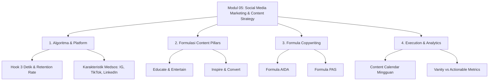

# 📚 Kisi-Kisi Pembelajaran: Modul 05 — Social Media Marketing & Content Strategy

**Mata Pelajaran**: Digital Marketing  
**Satuan Pendidikan**: SMK Telkom Malang  
**Kelas / Semester**: XI / Ganjil  
**Alokasi Waktu**: 2 JP (1 Pertemuan @ 90 Menit)  
**Target Modul**: Modul 05 — Social Media Marketing & Content Strategy  
**File Berkas Materi**: `05_Social_Media_Marketing_Dan_Content_Strategy.html`  
**File Bank Soal (GIFT)**: `soal_gift_05_social_media_marketing_dan_content_strategy.txt`  

---

## 🎯 Target Pembelajaran (Learning Objectives)

Setelah menyelesaikan Modul 05 ini, peserta didik diharapkan mampu:
1. **TP-01**: Mengidentifikasi karakteristik platform media sosial (Instagram, TikTok, YouTube Shorts, LinkedIn) dan cara kerja algoritma rekomendasi konten berbasis *retention rate* serta *hook rate*.
2. **TP-02**: Memahami dan merumuskan 4 Pilar Konten (*Content Pillars*: *Educate, Entertain, Inspire, Convert*) serta menyusun *Content Calendar* mingguan secara terstruktur.
3. **TP-03**: Menguasai dan menerapkan teknik *copywriting* persuasif berbasis formula **AIDA** (*Attention, Interest, Desire, Action*) dan **PAS** (*Problem, Agitate, Solution*) untuk berbagai *niche* bisnis.
4. **TP-04**: Mengukur dan menganalisis *Key Performance Indicators* (KPI) media sosial, membedakan *vanity metrics* dari *actionable metrics* (*Engagement Rate*, *CTR*, *Conversion Rate*).

---

## 📋 Matrix Rincian Sub-Modul & Alokasi Waktu

| No | Sub-Modul / Topik | Alokasi Waktu | Bentuk Aktivitas / Metode | Output Pembelajaran |
| :---: | :--- | :---: | :--- | :--- |
| **1** | **Anatomi Platform & Algoritma Medsos** | 20 Menit | Paparan Slide & Diskusi Kasus Algoritma TikTok vs Instagram | Pemahaman *Hook 3 Detik*, *Watch Time*, & *Signals* |
| **2** | **Formulasi Content Pillars & Ideasi** | 20 Menit | Workshop Pengelompokan Konten (*Educate, Entertain, Inspire, Convert*) | Peta Ide Konten Bisnis UMKM |
| **3** | **Teknik Copywriting Persuasif (AIDA & PAS)** | 25 Menit | Latihan Penulisan Copywriting & Diskusi Kelompok | Draf Copywriting Iklan & Caption Medsos |
| **4** | **Content Calendar & Social Media Analytics** | 25 Menit | Studi Kasus Analisis Matriks & Praktik Penyusunan Jadwal Konten | Berkas *Content Calendar* 1 Minggu & Analisis KPI |

---

## 🧠 Rincian Cakupan Materi Pembelajaran

### 1. Ekosistem & Algoritma Media Sosial Modern
- **Hook 3 Detik (*Golden Seconds*)**: Strategi menghentikan *scrolling* penonton menggunakan elemen visual yang mengejutkan, pertanyaan retoris, atau *bold statement*.
- **Retention Rate & Average Watch Time**: Mengapa algoritma TikTok & Instagram Reels mengutamakan persentase durasi tonton dibandingkan jumlah *followers*.
- **Karakteristik Platform**:
  - **TikTok & Instagram Reels**: Pendekatannya *entertainment-first*, mengutamakan tren audio, visual cepat, dan *relatable content*.
  - **LinkedIn**: Konten profesional, *thought leadership*, edukasi mendalam, dan *personal branding*.
  - **YouTube Shorts**: Pintu masuk menuju *long-form content* dengan retensi penonton yang konsisten.

### 2. Formulasi Content Pillars (Pilar Konten)
- **4 Pilar Utuh**:
  1. **Educate (Edukasi)**: Tips, tutorial, mitos vs fakta, infografis bermanfaat. (Membangun Otoritas Brand).
  2. **Entertain (Hiburan)**: Meme, parodi, konten *behind the scenes* (BTS), tren audio. (Meningkatkan Jangkauan / *Reach* & Viralitas).
  3. **Inspire (Inspirasi)**: *Storytelling* perjalanan pendiri, ulasan jujur konsumen (*UGC*), studi kasus sukses. (Membangun *Trust* & Ikatan Emosional).
  4. **Convert / Promote (Promosi)**: Penawaran diskon, *hard selling*, pameran fitur unggulan produk, testimoni. (Mendorong Penjualan / Transaksi).

### 3. Formula Copywriting Persuasif
- **Formula AIDA**:
  - **A - Attention**: Headline pemikat yang memicu rasa penasaran.
  - **I - Interest**: Menyajikan fakta atau emosi yang relevan dengan masalah pembaca.
  - **D - Desire**: Memperlihatkan transformasi atau manfaat setelah menggunakan produk.
  - **A - Action**: *Call to Action* (CTA) yang jelas dan tegas.
- **Formula PAS**:
  - **P - Problem**: Mengangkat titik nyeri (*pain point*) yang sedang dihadapi calon pembeli.
  - **A - Agitate**: Memperjelas dampak negatif jika masalah tersebut dibiarkan tanpa solusi.
  - **S - Solution**: Memperkenalkan produk/jasa sebagai jawaban terbaik dan paling praktis.

### 4. Content Calendar & Matriks Analytics
- **Metode Batch Production**: Menghemat waktu dengan memproduksi 5-10 konten dalam 1 hari pengambilan gambar.
- **Elemen Content Calendar**: Tanggal publish, Platform, Pilar Konten, Format Visual, Headline/Hook, Caption, CTA, & Status.
- **Diferensiasi Matriks**:
  - **Vanity Metrics**: Likes, Views, Followers (Hanya terlihat bagus di permukaan).
  - **Actionable Metrics**: Engagement Rate (ER), Click-Through Rate (CTR), Shares, Saves, & Conversion Rate (Berdampak langsung pada tujuan bisnis).

---

## 📊 Visualisasi Alur Pembelajaran (Mermaid Diagram)

---

## 📝 Panduan Asesmen & Rubrik Penilaian Tugas Praktik

### Tugas Mandiri / Kelompok: "Penyusunan Content Calendar & Copywriting UMKM"
Setiap siswa/kelompok diminta memilih 1 UMKM dan membuat **Content Calendar 1 Minggu (7 Hari)** yang mencakup 4 pilar konten serta 2 draf naskah *copywriting* (1 format AIDA & 1 format PAS).

| Kriteria Penilaian | Bobot | Indikator Keberhasilan |
| :--- | :---: | :--- |
| **Keseimbangan Content Pillars** | 30% | Memuat kombinasi proporsional pilar *Educate*, *Entertain*, *Inspire*, dan *Convert* (tidak hanya promosi jualan saja). |
| **Kualitas Copywriting (AIDA/PAS)** | 30% | Headline memiliki *Hook* kuat, alur teks mengalir, serta memuat CTA yang jelas dan persuasif. |
| **Kesesuaian Karakter Platform** | 20% | Pemilihan format visual (Reels/Carousels/Shorts) sesuai dengan kebiasaan pengguna platform yang dituju. |
| **Kerapian & Kejelasan Kalender** | 20% | Struktur *Content Calendar* lengkap memuat tanggal, platform, *caption*, hashtag, serta arahan visual. |

---
*Dibuat untuk Tim Pembelajaran Digital Marketing — SMK Telkom Malang.*
