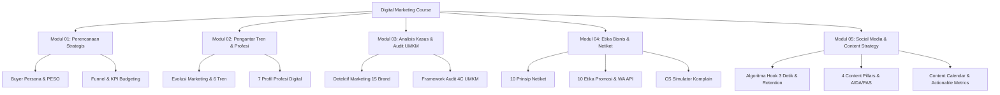

# 📚 Indeks Kisi-Kisi Pembelajaran Digital Marketing - SMK Telkom Malang

Berikut adalah daftar dokumen **kisi-kisi pembelajaran (blueprint / syllabus breakdown)** lengkap untuk seluruh modul pembelajaran Digital Marketing pada folder `Modul Ajar\Website\digital-marketing\materi`:

---

## 📂 Daftar Berkas Kisi-Kisi Per Materi

| No | Modul Pembelajaran | File Berkas Materi | Berkas Kisi-Kisi (Markdown) | Focus Utama Materi |
| :---: | :--- | :--- | :--- | :--- |
| **01** | **Modul 01: Perencanaan Digital Marketing** | `materi_1.pptx` | [kisi_kisi_01_perencanaan_digital_marketing.md](file:///d:/1.%20Projects/SMK%20Telkom%20Malang/Modul%20Ajar/Website/digital-marketing/materi/kisi_kisi_01_perencanaan_digital_marketing.md) | Konsep perencanaan strategis, Buyer Persona, PESO Framework, Marketing Funnel, KPI, & Budgeting. |
| **02** | **Modul 02: Pengantar Digital Marketing** | `02_Pengantar_Digital_Marketing.html` | [kisi_kisi_02_pengantar_digital_marketing.md](file:///d:/1.%20Projects/SMK%20Telkom%20Malang/Modul%20Ajar/Website/digital-marketing/materi/kisi_kisi_02_pengantar_digital_marketing.md) | Evolusi pemasaran ke era AI, 6 Tren Utama Digital Marketing, Ice Breaking Emoji, 7 Profil Profesi & Skills. |
| **03** | **Modul 03: Menganalisis Penerapan Digital Marketing** | `03_Menganalisis_Penerapan_Digital_Marketing.html` | [kisi_kisi_03_menganalisis_penerapan_digital_marketing.md](file:///d:/1.%20Projects/SMK%20Telkom%20Malang/Modul%20Ajar/Website/digital-marketing/materi/kisi_kisi_03_menganalisis_penerapan_digital_marketing.md) | Game "Detektif Marketing" (15 Brand Riil), Komparasi Brand Besar vs UMKM, Framework 4C, & Asesmen Audit UMKM. |
| **04** | **Modul 04: Etika Bisnis Digital dan Netiket** | `04_Etika_Bisnis_Digital_Dan_Netiket.html` | [kisi_kisi_04_etika_bisnis_digital_dan_netiket.md](file:///d:/1.%20Projects/SMK%20Telkom%20Malang/Modul%20Ajar/Website/digital-marketing/materi/kisi_kisi_04_etika_bisnis_digital_dan_netiket.md) | 10 Prinsip Netiket Virginia Shea, 10 Etika Emas Promosi Medsos, Etika WhatsApp API, 8 Langkah Komplain & CS Simulator. |
| **05** | **Modul 05: Social Media Marketing & Content Strategy** | `05_Social_Media_Marketing_Dan_Content_Strategy.html` | [kisi_kisi_05_social_media_marketing_dan_content_strategy.md](file:///d:/1.%20Projects/SMK%20Telkom%20Malang/Modul%20Ajar/Website/digital-marketing/materi/kisi_kisi_05_social_media_marketing_dan_content_strategy.md) | Algoritma Medsos, 4 Content Pillars, Copywriting AIDA & PAS, Content Calendar, & Actionable Analytics. |

---

## 🎯 Ringkasan Peta Kurikulum

---
*Dibuat untuk Tim Pembelajaran Digital Marketing — SMK Telkom Malang.*
